# P4-CAN 中文界面汉化 + iOS 外壳 App

给 ESP32-P4 车载 CAN 控制器 **[P4can-universal-unlock](https://github.com/06066060606060/P4can-universal-unlock)**
的网页仪表盘做了一套**中文界面汉化**，并把它包成了一个**原生 iOS App**（SwiftUI + WKWebView）。

- 汉化是**注入式的**：不动固件任何一行逻辑代码，只把页面上的英文换成中文，随时可以一条命令还原成英文。
- iOS App 是**纯外壳**：页面仍然由板子提供（`http://192.168.4.1`），App 负责全屏容器、本地网络权限、
  连不上时的原生引导页、设置面板与缓存管理。已打包成未签名 IPA，可直接用 Sideloadly / AltStore 自签安装。
- App **自带汉化脚本**，刷原厂英文固件也能显示中文；**没连设备**时还能进「界面预览」，用示例数据看仪表盘。

> **下载**：[Releases · v1.3.2](https://github.com/Kaiser-DMr/p4can-zh-ios/releases/latest)
> —— 未签名 IPA（`P4CAN-1.3.2-unsigned.ipa`）+ 汉化脚本（`zh-bilingual.js`）

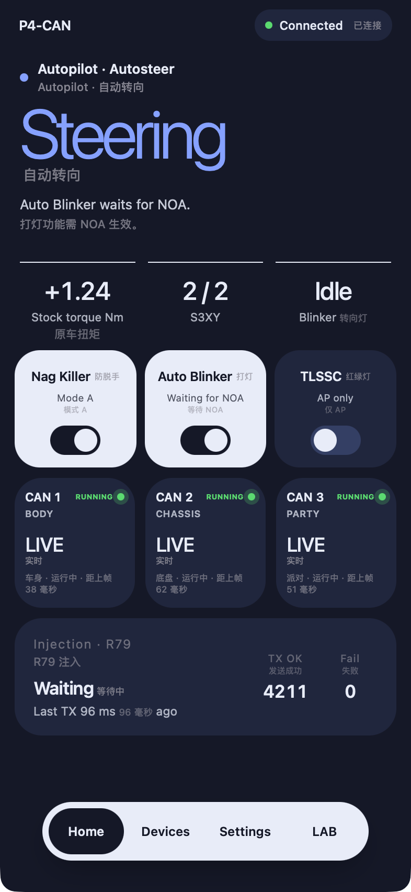

<p align="center">
  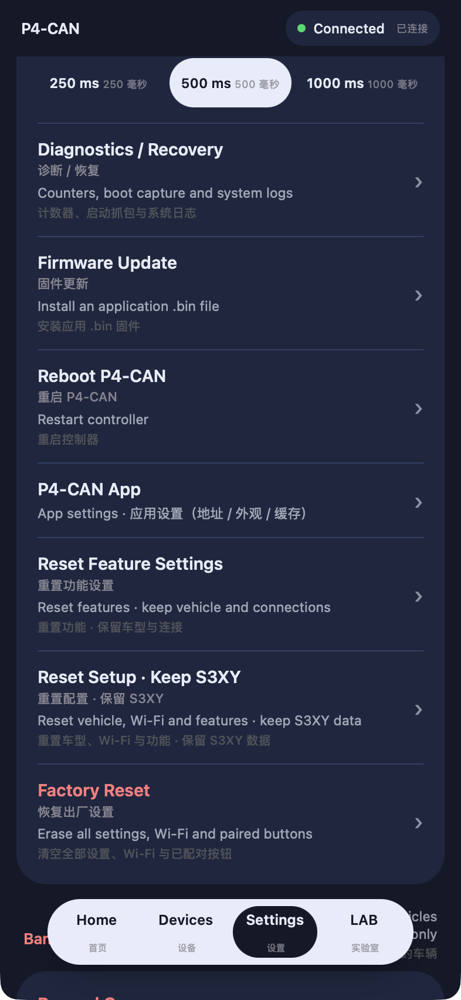
  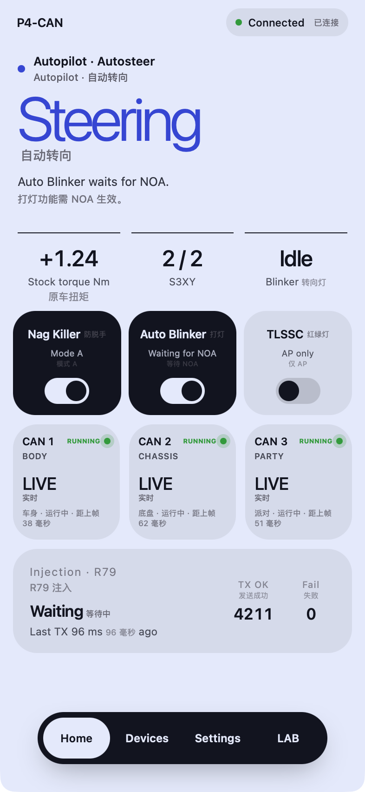
  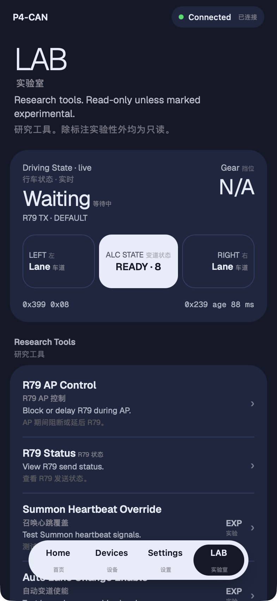
</p>

<p align="center"><sub>硬件实拍，摄于上一版「中英并列」；现在改成单语中文、排版更紧凑，效果见下方「界面预览」。</sub></p>

## 目录结构

```
.
├── README.md                     # 本文件
├── i18n/                         # 汉化补丁（注入式，不改固件逻辑）
│   ├── zh-bilingual.js           #   853 条词典 + 正则规则 + 文本替换引擎
│   ├── apply_zh.py               #   注入 / 还原，可重生成 index_html.h
│   └── README.md                 #   原理、覆盖率、排版坑、加词条方法
├── ios/                          # iOS 外壳 App（SwiftUI，iOS 16+，仅 iPhone）
│   ├── P4CAN/                    #   源码：入口、探活、网页容器、引导页、设置
│   │   ├── zh-bilingual.js       #   随包的汉化脚本（打包前从 i18n/ 同步）
│   │   ├── PreviewView.swift     #   离线界面预览容器
│   │   └── preview.html          #   示例页面（自写，不含上游代码）
│   ├── P4CAN.xcodeproj/          #   Xcode 工程（含共享 scheme，可直接打开跑）
│   ├── MacPreview/               #   macOS 真窗口预览（看液态玻璃，不入包）
│   ├── demo/                     #   本机模拟设备（没有硬件也能看连上之后的页面）
│   ├── tools/make-icon.py        #   图标流水线：源图 → 1024 满铺 → 各尺寸 + icns
│   ├── 图标/                      #   图标成品、多尺寸、深浅桌面预览
│   ├── 演示截图/                  #   App 内截图（含原厂固件下的英文界面）
│   ├── build-ipa.sh              #   编译 + 打未签名 IPA
│   └── README.md                 #   实现细节、视觉规范、预览方法
├── dist/
│   └── P4CAN-1.3.2-unsigned.ipa  # 未签名 IPA，1.4 MB（Release 同步一份）
└── docs/
    ├── install-guide.html        # 安装指南（Sideloadly 签名 / Xcode 直装 / 排错）
    ├── build-handbook.html       # 项目解读与硬件搭建手册
    ├── flash-cheatsheet.html     # 烧录速查卡
    ├── liquid-glass-design.html  # 液态玻璃设计稿（双机对照）
    └── screenshots/              # 文档配图
```

## 一、汉化

### 怎么用

```bash
# 1. 先自己 clone 上游固件（本仓库不包含上游任何代码）
git clone https://github.com/06066060606060/P4can-universal-unlock.git
cd P4can-universal-unlock

# 2. 注入中文，并重生成页面数据文件
python3 /path/to/i18n/apply_zh.py . --build

# 3. 照上游原有流程用 arduino-cli 编译烧录
```

- 第 2 步的 `--build` 不能省：仪表盘是**编译进固件**的（`dashboard_source.html` → `tools/build_dashboard.py`
  → `index_html.h`，gzip 后的字节数组），只改 html 不重生成头文件，烧进去不会变。
- 想还原成纯英文：把 `--build` 换成 `--revert --build`，注入块会被整段删掉。
- 补丁是幂等的，注入块由 `<!--P4ZH-BEGIN-->` / `<!--P4ZH-END-->` 包住，重复执行只替换这一段。

### 效果与代价

| | html | gzip（编进固件的就是这份） |
|---|---|---|
| 原始 | 365,384 | 82,209 |
| 汉化后 | 434,844 | 109,422 |

多 27 KB，占 4.8 MB APP 分区的 2.3%。软 AP 上首屏多 0.1~0.2 秒，之后走浏览器缓存。

中文是**直接改写文本节点**写的：英文原文被换成中文，不是并排追加。所以能选中、能复制、Ctrl+F 也搜得到，
页面上只有一份文字，不会因为多一行把窄卡片挤变形。原文存在内存里，控制台 `p4zh(false)` 可整体还原成英文。

细节见 [`i18n/README.md`](i18n/README.md)——包括哪些内容**故意保持英文**（徽标、寄存器名、总线名）、
几个必须知道的排版坑、以及怎么加词条。

## 二、iOS App

### 安装（不需要开发者账号）

1. 到 [**Releases**](https://github.com/Kaiser-DMr/p4can-zh-ios/releases/latest) 下载
   `P4CAN-1.3.2-unsigned.ipa`（仓库内也留了一份 [`dist/`](dist/) 备份；SHA-256 见文末）。
2. 用 [Sideloadly](https://sideloadly.io/) 或 AltStore 自签：把 IPA 拖进窗口，填自己的 Apple ID，Start。
3. 手机上 **设置 → 通用 → VPN 与设备管理 → 开发者 App** → 选自己的 Apple ID → **信任**。
4. 免费账号签出来的证书 **7 天过期**，到期重新签一次即可（App 内数据不会丢）。

> 需要 **iOS 16.0 以上的 iPhone**。v1.3.2 起不再声明 iPad 支持（车机上用不到，
> 且 iPad 版从未做过布局验证）；在 iPad 上仍可以 iPhone 兼容模式安装运行。

也可以直接用 Xcode 打开 `ios/P4CAN.xcodeproj` 跑到手机上，或用 `ios/build-ipa.sh` 自己打一份。

### 中文界面：不用刷汉化固件

App 里带了一份 `zh-bilingual.js`（就是 `i18n/` 里那一份，打包时自动同步），用 `WKUserScript`
在网页加载完后注入。**所以刷原厂英文固件，用这个 App 连上去看到的也是中文**：

| 固件 | 界面语言 | 设置入口 |
|---|---|---|
| 原厂 v3.29.3（英文） | 中文（App 注入） | 长按页面 0.7 秒 / 设置页的 `P4-CAN App` 行 |
| 打了汉化补丁的固件 | 中文（固件自带） | 设置页的 `P4-CAN App` 行 |

- 两种来源不会打架：补丁里加了单例守卫，固件已经内置汉化时，App 注入的这份会直接退出
  （实测固件版 `owner=firmware`，页面元素只被标记一次）。
- 关掉 **设置 → 语言 → 中文界面** 就是原始的英文页面，改了立刻重新加载生效。
- 注入发生在页面解析之后，为了不让你先看到一秒英文，`documentStart` 会把整页压成透明，
  注入完再淡入；脚本万一出错，1.2 秒的兜底定时器也会把页面显示出来（不会白屏）。
- 中文是**直接写进文本节点**的（不是伪元素），所以**能选中、能复制，Ctrl+F 也能搜到**；
  页面上只留一份文字，不会中英并排。原文记在内存里，控制台执行 `p4zh(false)` 可整体还原成英文。
- 如果固件跑的是上游那套「EN / 中」语言层（页面右上角有那个小按钮），App 会主动让位，
  并替你点一下切到中文，两套翻译不会互相覆盖。

### 没设备也能看：界面预览

连接页上有「界面预览」入口，不用刷板子、不用联网，直接看仪表盘长什么样：

<p align="center">
  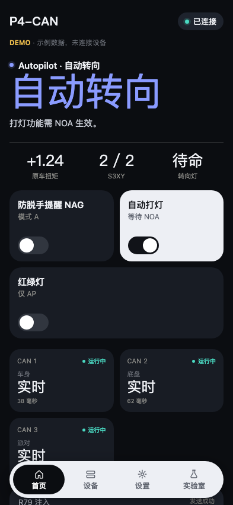
  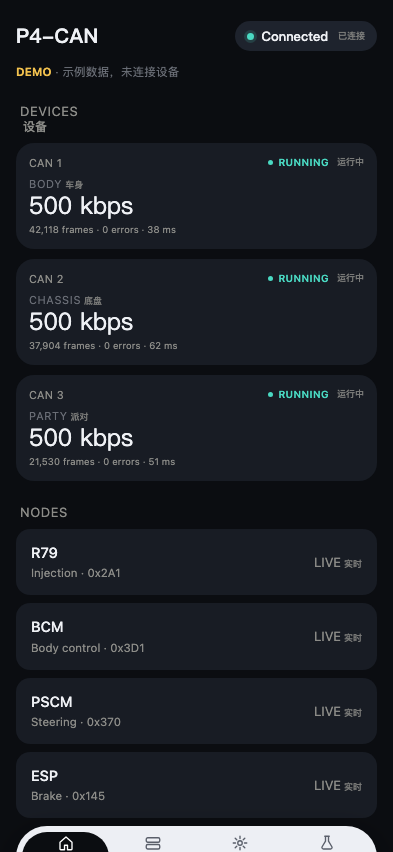
</p>

- 页面是**我们自己写的**（`ios/P4CAN/preview.html`），不包含上游任何代码；数据全是写死的示例值，
  顶部一直挂着 `DEMO · 示例数据，未连接设备`。
- 底部导航能切 Home / Devices / Settings / LAB，开关能点，纯演示，不会发任何报文。
- 中文同样走 `zh-bilingual.js` 注入，所以关掉「中文界面」这里也会跟着变英文——正好用来对比。

### 用法

1. 板子上电，手机连它的热点 `P4-CAN-XXXX`（密码 `12345678`）。
2. 打开 App。连不上时是原生引导页：三步说明、一键跳系统 WiFi 设置、手动填地址、常见问题排查。
3. 连上后自动进入仪表盘。下拉刷新；**长按页面 0.7 秒**可随时打开 App 设置。
4. App 设置里有：设备地址、外观（跟随系统 / 浅色 / 深色）、**中文界面开关**、清除网页缓存、重新加载。

### 实测过的两件事

- **配原厂固件也能用，而且也是中文**：网页本身是英文的原始页面，App 注入中文后正常显示
  （注入前的样子见[截图](docs/screenshots/device-stock-english.png)）。区别只有一个——原厂固件
  没有汉化补丁插入的那行 `P4-CAN App` 入口，此时靠**长按页面**进 App 设置，进过一次设置页后
  App 也会把那一行补上。
- **切后台/断网不崩**：探活每 3 秒一次，失败自动回到引导页，回来时再自动跳回仪表盘。

### 视觉

控制层（引导页按钮、底部操作条、提示横幅）用 iOS 26 的液态玻璃 `glassEffect`，内容层一律标准材质卡片——
这是 HIG 对 Liquid Glass 的硬性要求。旧系统自动回退 `ultraThinMaterial`，版式与信息层级不变。
背景是纯色磨砂（深 `#0B0D11` / 浅 `#F4F6F9`）+ 极细噪点，支持跟随系统 / 手动明暗切换。

设计稿：[在线预览](https://kaiser-dmr.github.io/p4can-zh-ios/liquid-glass-design.html) · 源文件 [`docs/liquid-glass-design.html`](docs/liquid-glass-design.html)

<p align="center">
  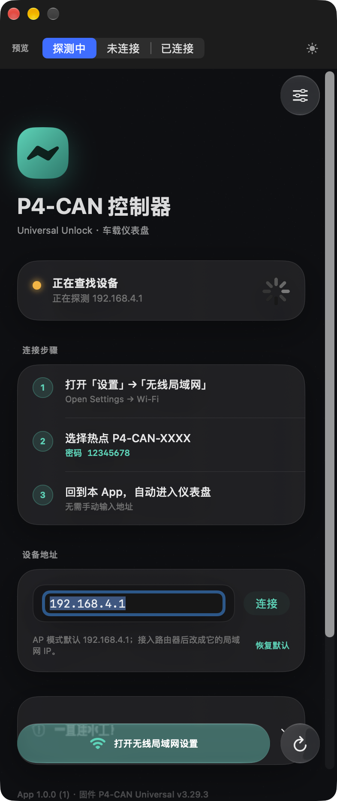
  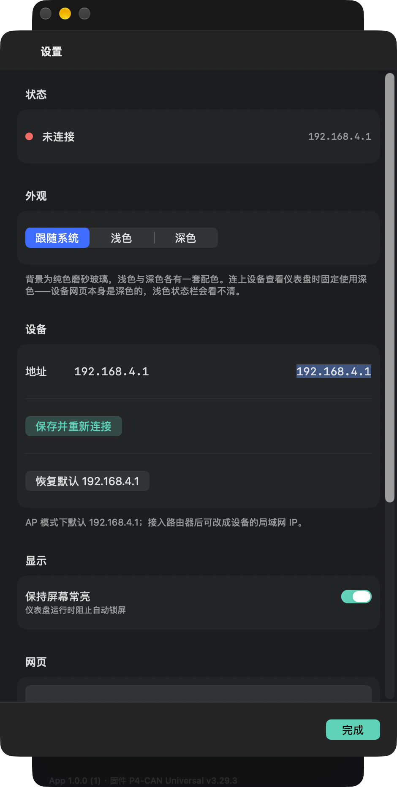
  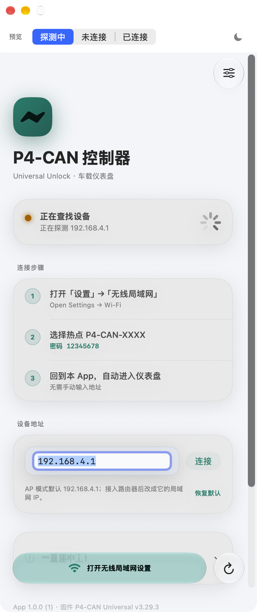
</p>

### 图标

<p align="center">
  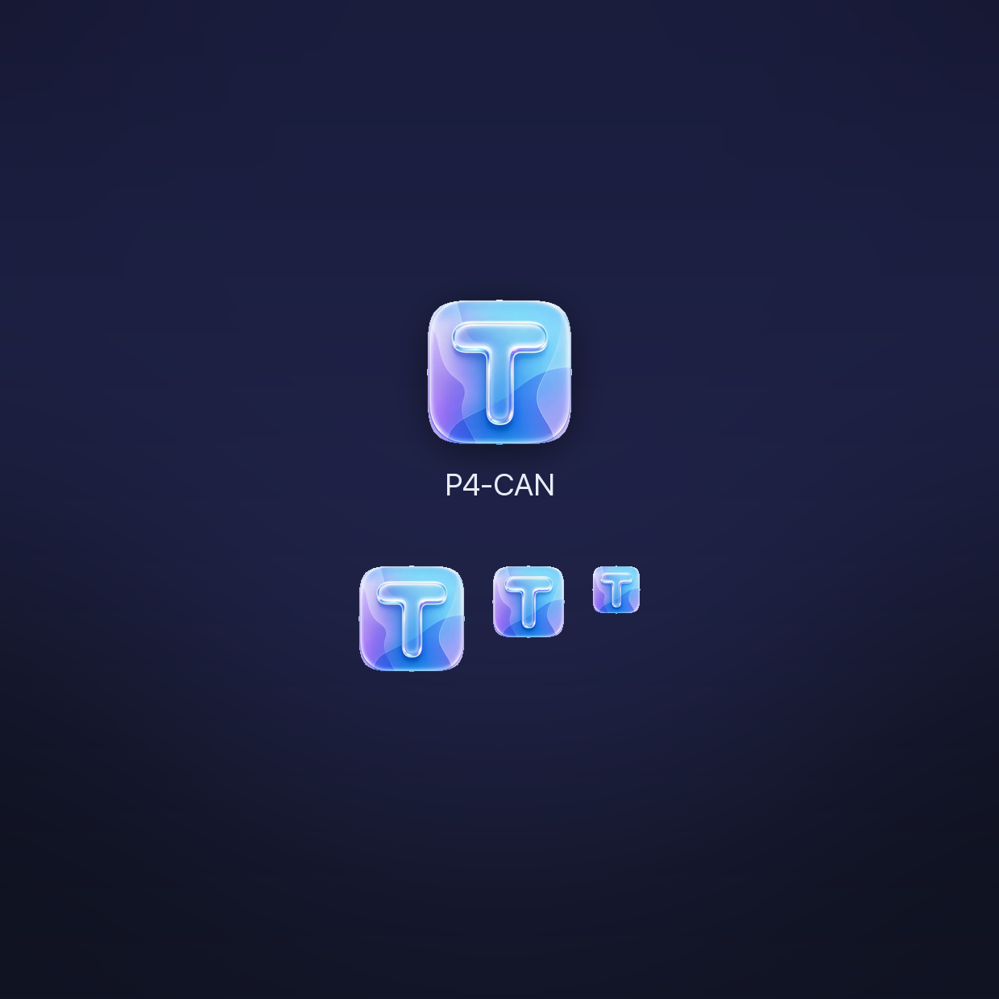
  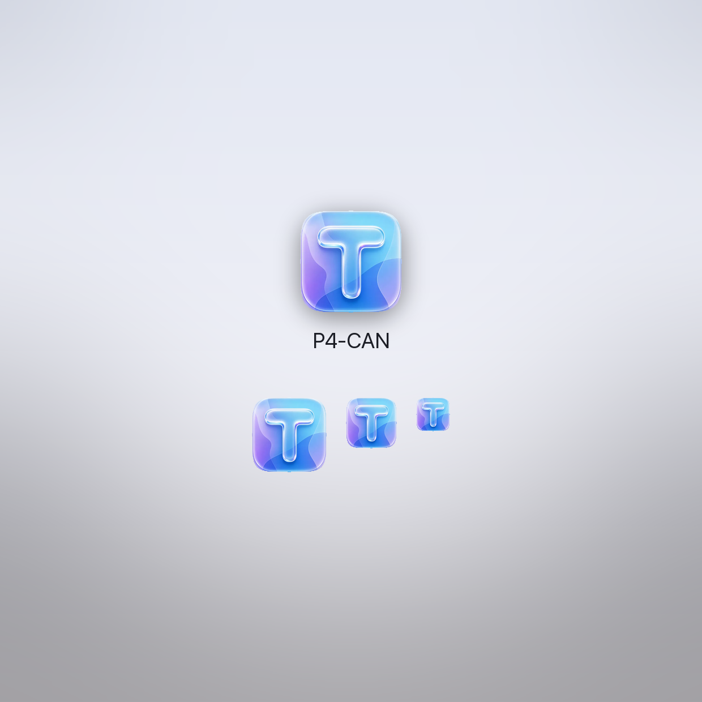
</p>

## 三、没有硬件也想看效果

`ios/demo/` 里有一个模拟设备：把汉化后的 `dashboard_source.html` 起成本地 HTTP，`/api/*` 用固定遥测数据应答，
再用 macOS 预览窗口以"已连接"状态嵌进去——看到的就是真机画面。

```bash
cd ios/demo && bash demo.sh

# 想直接停在某页 / 某个元素
START_PAGE=settings SCROLL_TO='#p4canAppRow' bash demo.sh
UNPATCHED=1 bash demo.sh          # 模拟原厂（未汉化）固件
```

## 四、从源码构建

```bash
cd ios
bash build-ipa.sh                 # → dist/P4CAN-1.3.2-unsigned.ipa（未签名）
python3 tools/make-icon.py 图.webp  # 换图标
```

需要 Xcode 16+ / iOS 26 SDK。`build-ipa.sh` 用 `CODE_SIGNING_ALLOWED=NO` 出未签名包，
再打成 `Payload/` 结构的 zip——签名的活儿交给 Sideloadly。

## 文档

在线看（HTML 已发布到 GitHub Pages，手机也能打开）：<https://kaiser-dmr.github.io/p4can-zh-ios/>

| 文档 | 内容 |
|---|---|
| [安装指南](https://kaiser-dmr.github.io/p4can-zh-ios/install-guide.html) | Sideloadly 签名步骤、Xcode 直装、常见报错、配哪种固件 |
| [项目解读与搭建手册](https://kaiser-dmr.github.io/p4can-zh-ios/build-handbook.html) | 硬件清单、接线、编译环境、三路 CAN 说明 |
| [烧录速查卡](https://kaiser-dmr.github.io/p4can-zh-ios/flash-cheatsheet.html) | 一页纸的编译烧录命令与分区参数 |
| [液态玻璃设计稿](https://kaiser-dmr.github.io/p4can-zh-ios/liquid-glass-design.html) | 双机对照、色板、圆角与栅格 |

源文件在 [`docs/`](docs/) 下，直接双击本地打开也可以（都是自包含的单文件 HTML，无外部依赖）。

## 致谢

本项目**完全建立在**下面这个开源项目之上，没有它就没有这里的一切：

- **[06066060606060 / P4can-universal-unlock](https://github.com/06066060606060/P4can-universal-unlock)**
  —— ESP32-P4 三路 CAN 固件、网页仪表盘、车型 profile 与全部功能逻辑，均出自该项目作者。
  汉化补丁只是给它加了一层中文注释，iOS App 只是给它套了一个原生外壳。
  如果这个项目对你有用，请去上游仓库给原作者点 Star。

本仓库**不包含**上游固件的任何源码或二进制，使用前请自行从上游获取，并遵守其许可与使用条款。

## 说明

- 汉化补丁与 iOS 外壳代码为本仓库作者编写，可自由参考、修改、再发布（保留本致谢即可）。
- 所有操作均涉及**车辆改装**，存在安全与保修风险，请自行评估。请遵守当地法律法规，
  仅在封闭道路或私人场地测试，不要在公共道路上使用影响安全的改装功能。
- 固件与车辆的适配、刷写风险由使用者自行承担。

---

`dist/P4CAN-1.3.2-unsigned.ipa`（与 Release v1.3.2 附件为同一文件）

```
大小    1,448,205 字节
SHA-256 b788816faa0ef99c943be0ba3f7acfa11aaa620566759c99665aded879f7d734
```
